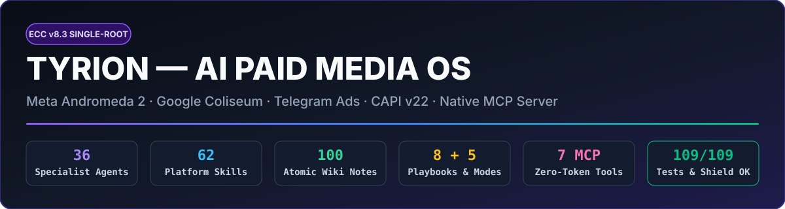

<p align="center">
  
</p>

# 🧠 TYRION v8.3 — YOPIQ SIKLLI MEDIA-BUYER MIYASI

[](./CHANGELOG.md)
[](./LICENSE)

<!-- tyrion:catalog agents=19 skills=19 wiki=101 playbooks=9 contexts=6 commands=42 rules=9 tools=40 -->

Tyrion rasmiy konnektorlardan jonli ma'lumot oladi, **har bir raqamni kod bilan hisoblaydi**, hisobni har kuni kuzatadi, testlardan o'rganadi va CRM'dagi lid sifatini Meta'ga qaytaradi. Doimiy kontekst narxi v7.1 dagi ≈10.4K dan ≈2K tokenga tushdi (`python3 tools/token-budget.py`). Claude Code, Codex, Cursor va Windsurf'da ishlaydi.

```text
ulash (MCP / token / CSV) → snapshot → normalize (metrics.v1) → tahlil / pulse → qaror (change packet) → test → saboq → CRM → CAPI
```

## O'rnatish

```bash
/plugin install tyrion --marketplace salohiddinayydigital-sudo/ai-ads
```

Python 3.10–3.13 (faqat stdlib) va Node 18+ kerak. Hisobsiz sinab ko'rish: `python3 tools/tyrion.py demo` — sintetik demo, pulse ogohlantirishlari va mustaqil HTML hisobot.

## 3 ta namunaviy so'rov

```text
"Meta reklamamdan kelayotgan lidlar sifatsiz, sababini top"
"Mana CSV eksport. Qaysi reklamani o'chirib, qaysini masshtablay?"
"Haftalik hisobot tayyorla: Telegram va Meta, natijalar va keyingi qadamlar"
```

Agent yoki asbobni siz tanlamaysiz: `tyrion` skilli yagona dirijyor. Eski buyruqlar (`/auditoriya`, `/kreativ`, `/voronka`, `/eksport`, `/hisobot`, `/mijoz`, `/raqobatchi`, `/savol`) saqlangan.

## Konnektorlarni sozlash (ustuvorlik)

1. **Rasmiy Meta Ads MCP** (OAuth) — `https://mcp.facebook.com/ads` *(Meta rasmiy hujjatidan tasdiqlangan, 2026-11-19)*.
2. **Google Ads MCP** — [googleads/google-ads-mcp](https://github.com/googleads/google-ads-mcp).
3. Graph API token (`META_ACCESS_TOKEN`) → 4. CSV/JSON eksport → 5. screenshot.

Batafsil: [docs/integrations.md](docs/integrations.md), `skills/connect/`.

## Xavfsizlik

Hisobga yozish asboblari (`ads_create_*`, `ads_update_entity`, `ads_activate_entity`, …) `PreToolUse` hook bilan himoyalangan: `clients/<slug>/changes/` da tasdiqlangan, 24 soatdan yangi, rollback rejali `change-packet.v1` kerak (`strict` — rad, `standard` — so'raydi). Chegaralar: [hooks/README.md](hooks/README.md).

## Tarkib

- **19 ta ixtisoslashgan agent**, **19 ta skill**, **42 ta slash buyruq** (12 tasi model ko'radi), **40 ta 0-token Python asbob**, **101 ta wiki qayd**, 9 playbook. 19 agent = 12 core + 7 targetolog yordamchi (`client-onboarder`, `ad-spy-analyst`, `campaign-launcher`, `daily-optimizer`, `funnel-cro-doctor`, `account-recovery-specialist`, `client-comms-lead`); buyruqlar: `/onboard /ad-spy /launch-plan /morning-triage /cro-dm /appeal /client-update`.
- 7.x dan o'tish: [MIGRATION.md](MIGRATION.md). O'zbekiston bozori paketi `market=uz` bo'lganda yuklanadi (Telegram, AmoCRM, Payme/Click, Uzum Nasiya).

## Litsenziya

[MIT](./LICENSE) · [NOTICE](NOTICE) · [THIRD_PARTY.md](THIRD_PARTY.md)
