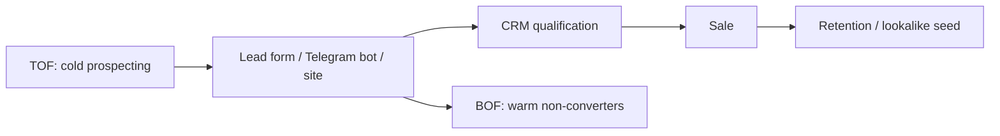

# Meta Ads strategiyasi: ish jarayoni va mijozga tayyor natija

`meta_strategy` workflow'ida (`manifests/workflows.json`) va Meta/Facebook/Instagram reklama strategiyasi so'ralgan har qanday so'rovda ishlatiladi. Faqat rejalash: bu yerdagi hech narsa jonli akkauntni o'zgartirmaydi.

## 0. Muzokara qilinmaydigan qoidalar

1. Har bir raqam, da'vo va tavsiya yorliqqa ega bo'ladi: `USER_PROVIDED`, `MEASURED_ACCOUNT_DATA`, `SOURCED` (manba bilan), `HEURISTIC_PRIOR_MODEL`, `ASSUMPTION`. Yorliqsiz raqamlar natijada ruxsat etilmaydi (`rules/00-manba.md`).
2. Ustunliklar, sharhlar, statistika, bozor hajmlari, kafolatlar yoki raqobatchi faktlarini hech qachon to'qimang. `[ADD VERIFIED ...]` o'rin egalaridan foydalaning va ularni "Ochiq kirishlar" da sanang.
3. Kafolatlangan CPA/CPL/ROAS/konversiyalar yo'q va universal benchmarklar yo'q. Maqsadlar mijozning o'z iqtisodidan chiqariladi (`calculator.py funnel-economics`).
4. O'zgaruvchan platforma faktlari (funksiyalar, spetsifikatsiyalar, policy, minimal byudjetlar, Advantage+ xatti-harakati) fakt sifatida aytilishidan oldin Meta'ning joriy hujjatlari yoki jonli akkaunt bilan tekshiriladi; aks holda "ishga tushirishdan oldin tekshiring" deb yozing.
5. Haqiqiy ko'rib chiqishsiz policy-muvofiqlik da'volari yo'q; "tasdiq emas, xavf baholash" deb ayting.

## 1. Kirishlar inventari (faqat birinchi bosqichni to'sib turgan narsani so'rang)

| Kirish | Nima uchun | Yetishmasa |
|---|---|---|
| Mahsulot/xizmat, taklif, narx, yetkazib berish/sotuv jarayoni | diagnostika, iqtisod | so'rang (to'sadi) |
| COGS yoki marja, to'lov/qayta ishlash to'lovlari | break-even | so'rang; aks holda o'rin egalari bilan formulani ko'rsating |
| Maqsad (lid/sotuv/bron/ilova) va muddat | maqsad, voronka | so'rang (to'sadi) |
| Oylik yoki kunlik byudjet | test va masshtab | so'rang; aks holda uchta byudjet darajasini ko'rsating |
| Lid-sotuv konversiyasi, o'rtacha buyurtma, takroriy daraja | CPL/CPA maqsadlari, LTV | o'lchash rejasi bilan `ASSUMPTION` oralig'i |
| Pixel/CAPI/CRM/Telegram-bot holati, domen, eventlar | o'lchov rejasi | noma'lum deb audit qiling, avval sozlashni rejalang |
| Mavjud auditoriyalar/mijoz ro'yxatlari/reklama tarixi, eksportlar | auditoriya va o'rganish | sovuqdan boshlang; seedlarni rejalang |
| Raqobatchilar, sharhlar, aktivlar (video/foto/isbot) | pozitsiyalash, kreativ | tadqiqot bosqichi yoki o'rin egalari |
| Cheklovlar: tartibga solinadigan kategoriya, geo, til, lidlarni qayta ishlash quvvati | policy, masshtab shifti | xavfni belgilang |

## 2. Ish jarayoni (har bir bosqich nimani berishi kerak)

| Bosqich | Egasi | Natija | Asboblar |
|---|---|---|---|
| intake | dirijyor | `business_brief`: tasdiqlangan faktlar va taxminlar jadvali | `ads-plan` |
| research | research-worker | manbali raqobatchi/bozor topilmalari (faqat haqiqatan ko'rilgan; Ads Library elementlari keltirilgan) | `ads-competitor`, `customer-research` |
| economics | audit-budget | break-even/maqsad CPA, CPL, ROAS, test byudjeti, ssenariylar, masshtab chegaralari | `calculator.py breakeven`, `funnel-economics` |
| positioning | positioning-strategist | ICP va personalar, segment bo'yicha xabardorlik bosqichi, og'riqlar/istaklar/e'tirozlar, USP, konversiya to'siqlari | `ads-dna`, `product-marketing` |
| architecture | launch-planner | maqsadlar, voronka, kampaniya/ad set tuzilmasi, ABO/CBO, Advantage+ va qo'lda, byudjet bo'linishi, test/masshtab mantig'i, yo'l xaritasi | `ads-plan`, `ads-launch` |
| audience | meta-audience-architect | 4 qatlamli auditoriya xaritasi, exclusion'lar, 6 statusli tekshiruvli targeting ro'yxati | `meta-targeting-engine.py`, `meta-audience.py` |
| creative | creative-strategist | angle x avatar x format matritsasi, konsept brifleri, test gipotezalari | `creative-matrix.py` |
| tracking | tracking-specialist | event taksonomiyasi, dedup, UTM, CRM/oflayn fikr-mulohaza rejasi, atributsiya cheklovlari | `capi-utm-builder.py` |
| video | reels-scriptwriter | syomkaga tayyor ssenariylar sifatida eng yaxshi 1–2 konsept (`skills/video/references/reels-scripting/references/performance-video-system.md` ga qarang) | `creative-matrix.py video-script` |
| validate | source-verifier | da'volar jadvali: qo'llab-quvvatlanadi / qo'llab-quvvatlanmaydi / manba kerak | - |
| synthesize | dirijyor | quyidagi 15 bo'limli hujjat | - |

## 3. Qaror freymvorklari (natijada tanlov va sababni ko'rsating)

**Voronka qo'llanilishi** — TOF/MOF/BOF/Retention ni hamma joyda majburlamang. Har bir biznes uchun hal qiling:

| Vaziyat | Voronka | Aytiladigan sabab |
|---|---|---|
| Yangi reklama beruvchi, pixel tarixi yo'q, kichik byudjet | Faqat TOF konversiya testi + to'g'ri exclusion'lar; retargeting faqat havzalar o'rganishi mumkin bo'lgan hajmga yetganda | auditoriya havzalari foydali retargeting uchun juda kichik |
| Qisqa qaror sikli bo'lgan mahalliy xizmat (klinika, kurslar, ta'mirlash) | TOF dan lid formasi/Telegram/DM ga + tezkor keyingi aloqa; BOF = bron qilmagan iliq lidlar | sotuv tezligi foydani hal qiladi |
| Qimmat yoki uzun sikl | TOF + MOF isbot/ta'lim + BOF retargeting + CRM nurture | so'rovdan oldin ishonch kerak |
| Katalog va xarid tarixi bor e-commerce | Advantage+ sales kampaniyasi plus saqlash/upsell | avtomatlashtirish uchun yetarli eventlar |
| Mavjud mijoz bazasi | Saqlash va lookalike seedlarini qo'shing | seedlar mavjud |

**Tuzilma tanlovlari**: Advantage+ (avtomatlashtirish) va qo'lda — konversiya hajmi va kreativ xilma-xilligi yetarli bo'lsa va akkauntda toza signallar bo'lsa avtomatlashtirishni afzal ko'ring; kichik byudjetlarda nazorat qilinadigan kreativ/auditoriya testlari uchun qo'lda/ABO. CBO va ABO — test uchun ABO (har bir katakka teng sarf), isbotlangan ad set'larni masshtablash uchun CBO/Advantage byudjet. Broad va Detailed Targeting — kreativ targetingni ko'targanda, pixel/CAPI signal sifati yaxshi va hajm mavjud bo'lganda Broad; sovuq testlar, kichik bozorlar yoki Broad o'rganishni isrof qiladigan nishalar uchun gipoteza qatlami sifatida Detailed Targeting. Har doim qanday dalil tanlovni o'zgartirishini ayting. Lookalike faqat yaroqli seed bilan (sifatli konversiyalar, yetarli hajm); retargeting oynalari sotuv siklini kuzatadi.

**Byudjet**: `funnel-economics` dan chiqaring (qarorgacha yetish narxi, ad set uchun o'rganishga mos sarf, Spend-Guard +20% o'zgarish doirasidagi masshtab qadamlari). Har bir daraja nimani isbotlay olishi va olmasligi bilan uchta darajani bering (minimal yaroqli test / tavsiya etilgan / agressiv).

## 4. Auditoriya va targeting qoidalari

- Nomzod qiziqish/xatti-harakatlar uchun `meta-targeting-engine.py search` ni ishga tushiring. Asl Meta nomi va ID'ni aynan qaytarilganidek saqlang. Statuslar: `VERIFIED_AVAILABLE`, `FOUND_NOT_VALIDATED`, `UNAVAILABLE_OR_CONSOLIDATED`, `RELATED_UNVERIFIED`, `NOT_FOUND`, `API_UNAVAILABLE`.
- Faqat `VERIFIED_AVAILABLE` elementlar "foydalanishga tayyor" ro'yxatga tushadi. Qolganlari Ads Manager Detailed Targeting'da tekshiriladigan gipotezalar deb belgilanadi. API mavjud bo'lmasa (token yo'q), buni ayting; nomzodlarni tasdiqlangan deb ko'rsatmang.
- Har bir element uchun: nega bu ICP uchun tegishli, kutilgan roli (sovuq test / broad yordam / exclusion) va holati. Ro'yxatni to'ldirish o'rniga tegishli bo'lmagan yoki to'qilgan variantlarni olib tashlang.
- Har bir qatlam uchun exclusion'lar (mavjud mijozlar, yaqinda lidlar, imkon bo'lsa xodimlar/raqobatchilar, faol DM suhbatlari), Static Pool Overlap tekshiruvi (`meta-audience.py overlap`, maqsad 20% dan past), kichik auditoriyalar uchun to'yinish tekshiruvi.
- Special Ad Categories (kredit, uy-joy, bandlik) targetingni cheklaydi; tegishli bo'lsa, buni ayting.

## 5. Treking va o'lchov bo'limi qamrab olishi kerak

Pixel va Conversions API (brauzer + server), event ro'yxati va ustuvorligi, deduplikatsiya (`event_id`), rozilik, UTM taksonomiyasi, lid malakasi va CRM bosqich xaritasi, oflayn konversiya fikr-mulohazasi, Telegram bot/DM voronka o'lchovi (deep-link payload'lar, start eventlari), atributsiya oynasi chegaralari va Ads Manager hamda haqiqiy daromad o'rtasidagi bo'shliq. Muvaffaqiyat biznes natijalari (malakali lidlar, sotuvlar, marja) bilan o'lchanadi, Ads Manager metrikalari esa diagnostika sifatida.

## 6. 15 bo'limli mijoz natijasi

Foydalanuvchi tilida yozing (standart o'zbek lotin; so'ralganda rus/ingliz), ixcham, jadvallar bilan. Raqamlar paydo bo'lgan har bir bo'lim dalil yorlig'i xulosasi bilan tugaydi.

1. **Ijroiya xulosa** - tavsiya, Meta'ning kutilgan roli, uchta asosiy raqam (yorliqli), kerakli birinchi qaror.
2. **Biznes diagnostikasi** - mahsulot/taklif tahlili, unit-iqtisod snapshoti, konversiya to'siqlari.
3. **Auditoriya tahlili** - ICP, personalar, xabardorlik bosqichlari, og'riqlar, istaklar, e'tirozlar, xarid motivatsiyalari.
4. **Bozor va raqobatchi insaytlari** - faqat haqiqatan kuzatilgan, manbalar bilan; pozitsiyalash bo'shlig'i va USP.
5. **Kampaniya maqsadlari** - biznes maqsadi -> Meta maqsadi -> optimallashtirish eventi, sababi bilan.
6. **Voronka arxitekturasi** - faqat qo'llaniladigan bosqichlar, boshqalar nega chiqarilgani sababi bilan; diagramma.
7. **Kampaniya tuzilmasi** - kampaniyalar, ad set'lar, reklamalar, nomlash, ABO/CBO va Advantage+ qarorlari, diagramma.
8. **Auditoriya va targeting** - 4 qatlamli xarita, tasdiqlangan targeting jadvali (nom, ID, status, rol), exclusion'lar, broad va detailed asosi.
9. **Byudjet** - iqtisod jadvali (break-even va maqsad CPA/CPL/ROAS), uchta byudjet darajasi, test byudjeti, masshtab qoidalari.
10. **Kreativ strategiya** - angle x format matritsasi, konseptlar, isbot rejasi, ishlab chiqarish ehtiyojlari; video ssenariylar ilovasi.
11. **Treking** - o'lchov rejasi va bo'shliqlar (to'sadigan va to'smaydigan).
12. **Test rejasi** - gipotezalar (bitta o'zgaruvchi, qaror qoidasi, minimal ma'lumot), ketma-ketlik, doimiy qoladigan narsalar.
13. **Optimallashtirish va masshtablash yo'l xaritasi** - jadval: bosqich, harakatlar, bog'liqliklar, egasi, metrikalar, qaror mezonlari (quyida).
14. **Ssenariylar va taxminlar** - `funnel-economics` dan pessimistik/bazaviy/optimistik, har birini qanday tekshirish bilan taxminlar reyestri.
15. **Xavflar va tavsiyalar** - policy, treking, quvvat (mijoz lidlarni qayta ishlay oladimi?), kreativ ta'minot, taxminlarga bog'liqlik; ustuvor keyingi 5 harakat.

### Yo'l xaritasi jadval shabloni

| Bosqich | Harakatlar | Bog'liq | Egasi | Metrikalar | Go / no-go qaror mezonlari |
|---|---|---|---|---|---|
| Tayyorgarlik | pixel/CAPI/UTM, aktivlar, landing/bot, CRM xaritasi | mijoz kirishlari | mijoz + treking | eventlar ishlayapti, dedup yaxshi | barcha to'sadigan treking bandlari yopilgan |
| Ishga tushirish | arxitekturaga ko'ra test tuzilmasini yaratish | tayyorgarlik | media buyer | yetkazib berish, o'rganish holati | policy bayroqlari yo'q, byudjet shiftlari o'rnatilgan (Spend-Guard) |
| Test | angle/format kataklari, teng sarf | ishga tushirish | media buyer + kreativ | hook rate, hold rate, outbound CTR, CPL, lid sifati | har bir test uchun oldindan ro'yxatdan o'tgan |
| Ma'lumot yig'ish | qaror hajmidagi tanlamalarni to'plash | test | tahlilchi | katak bo'yicha konversiyalar, CRM bosqichi | minimal tanlamaga yetildi (iqtisoddan) |
| Optimallashtirish | kill/keep/promote | ma'lumot | media buyer | CPA va break-even/maqsad, marginal CPA | umumiy emas, iqtisoddan olingan chegaralar |
| Kreativ iteratsiya | diagnostikadan yangi konseptlar | optimallashtirish | kreativ | bosqich bo'yicha diagnostika (`creative-matrix.py iterate`) | g'olib CRM sifati bilan aniqlanadi |
| Masshtablash | +20% qadamlar yoki gorizontal klonlar | tasdiqlangan CPA | media buyer | marginal CPA, frequency, to'yinish | marginal CPA break-even'dan past |
| Hisobot | haftalik/oylik | hammasi | tahlilchi | birlashgan ROAS, sof naqd pul, CRM daromadi | hisobot mijoz tomonidan qabul qilingan |

### Diagramma shablonlari

Tugunlarni 6-bo'limda tanlangan haqiqiy voronka bilan almashtiring.

## 7. O'zbekiston bozori eslatmalari (faqat mijoz u yerda faoliyat yuritganda; mijoz ma'lumotlari bilan tekshiring)

O'zbek (lotin/kirill) va rus tili bo'linishi kreativ va targetingga ta'sir qiladi; alohida yoki moslashtirilgan kreativlarni rejalang, hech qachon so'zma-so'z tarjima emas. Ko'plab voronkalar veb-saytda emas, Telegram botlar/DM yoki telefon qo'ng'iroqlarida tugaydi: bu qadamlarni aniq o'lchang. To'lov xatti-harakati (BNPL/Uzum Nasiya kabi bo'lib to'lash, Payme/Click) taklifni o'zgartirishi mumkin; qaysi biri mijoz tomonidan tasdiqlanganini ayting. Manbasiz bozor raqamlarini da'vo qilmang.

## 8. Topshirishdan oldin o'z-o'zini tekshirish

Barcha 15 bo'lim mavjud; raqamlar mos keladi (byudjet = kampaniyalar yig'indisi; hajmlar CPL/CVR taxminlariga mos); har bir targeting elementining holati bor; har bir o'rin egasi "Ochiq kirishlar" da sanalgan; taxminlar reyestri to'liq; kafolatlar yo'q; bajarish hisoboti qaysi bosqichlar native, zaxira sifatida bajarilgani yoki o'tkazib yuborilganini va qaysi asboblar haqiqatan ishga tushganini ko'rsatadi.
