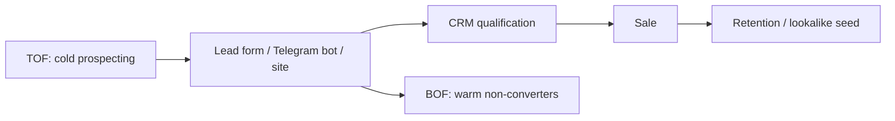

# Meta Ads Strategy: workflow and client-ready deliverable

Used by the `meta_strategy` workflow (`manifests/workflows.json`) and by any request for a Meta/Facebook/Instagram advertising strategy. Planning only: nothing here changes a live account.

## 0. Non-negotiables

1. Every figure, claim and recommendation carries a label: `USER_PROVIDED`, `MEASURED_ACCOUNT_DATA`, `SOURCED` (with source), `HEURISTIC_PRIOR_MODEL`, `ASSUMPTION`. Unlabelled numbers are not allowed in the deliverable (`rules/00-manba.md`).
2. Never invent advantages, testimonials, statistics, market sizes, guarantees or competitor facts. Use `[ADD VERIFIED ...]` placeholders and list them in "Open inputs".
3. No guaranteed CPA/CPL/ROAS/conversions and no universal benchmarks. Targets are derived from the client's own economics (`calculator.py funnel-economics`).
4. Volatile platform facts (features, specs, policies, minimum budgets, Advantage+ behavior) are verified against Meta's current documentation or the live account before they are stated as fact; otherwise write "verify before launch".
5. No policy-compliance claims without a real review; say "risk assessment, not approval".

## 1. Input inventory (ask only for what blocks the first stage)

| Input | Why | If missing |
|---|---|---|
| Product/service, offer, price, delivery/sales process | diagnosis, economics | ask (blocking) |
| COGS or margin, payment/processing fees | break-even | ask; else show formula with placeholders |
| Goal (leads/sales/bookings/app) and time frame | objective, funnel | ask (blocking) |
| Monthly or daily budget | testing vs scaling | ask; else show three budget tiers |
| Lead-to-sale conversion, average order, repeat rate | CPL/CPA targets, LTV | `ASSUMPTION` range with a plan to measure |
| Pixel/CAPI/CRM/Telegram-bot state, domain, events | measurement plan | audit as unknown, plan setup first |
| Existing audiences/customer lists/ad history, exports | audience and learning | start cold; plan seeds |
| Competitors, reviews, assets (videos/photos/proof) | positioning, creative | research stage or placeholders |
| Constraints: regulated category, geo, language, capacity to handle leads | policy, scale ceiling | flag risk |

## 2. Workflow (what each stage must produce)

| Stage | Owner | Output | Tools |
|---|---|---|---|
| intake | conductor | `business_brief`: verified facts vs assumptions table | `ads-plan` |
| research | research-worker | competitor/market findings with sources (only what was actually seen; Ads Library items cited) | `ads-competitor`, `customer-research` |
| economics | audit-budget | break-even/target CPA, CPL, ROAS, test budget, scenarios, scale limits | `calculator.py breakeven`, `funnel-economics` |
| positioning | positioning-strategist | ICP and personas, awareness stage per segment, pains/desires/objections, USP, conversion barriers | `ads-dna`, `product-marketing` |
| architecture | launch-planner | objectives, funnel, campaign/ad set structure, ABO/CBO, Advantage+ vs manual, budget split, test/scale logic, roadmap | `ads-plan`, `ads-launch` |
| audience | meta-audience-architect | 4-layer audience map, exclusions, targeting list with 6-status verification | `meta-targeting-engine.py`, `meta-audience.py` |
| creative | creative-strategist | angle x avatar x format matrix, concept briefs, test hypotheses | `creative-matrix.py` |
| tracking | tracking-specialist | event taxonomy, dedup, UTM, CRM/offline feedback plan, attribution limits | `capi-utm-builder.py` |
| video | reels-scriptwriter | top 1-2 concepts as shoot-ready scripts (see `skills/video/references/reels-scripting/references/performance-video-system.md`) | `creative-matrix.py video-script` |
| validate | source-verifier | claims table: supported / unsupported / needs source | - |
| synthesize | conductor | the 15-section document below | - |

## 3. Decision frameworks (state the choice and the reason in the deliverable)

**Funnel applicability** - do not force TOF/MOF/BOF/Retention everywhere. Decide per business:

| Situation | Funnel | Reason to state |
|---|---|---|
| New advertiser, no pixel history, low budget | TOF-only conversion test + proper exclusions; retargeting only once pools reach a size that can learn | audience pools too small to retarget profitably |
| Local service with a short decision cycle (clinic, courses, repair) | TOF to lead form/Telegram/DM + fast follow-up; BOF = warm leads who did not book | sales speed decides profit |
| High-ticket or long cycle | TOF + MOF proof/education + BOF retargeting + CRM nurture | trust needed before inquiry |
| E-commerce with catalog and purchase history | Advantage+ sales campaign plus retention/upsell | enough events for automation |
| Existing customer base | Add retention and lookalike seeds | seeds exist |

**Structure choices**: Advantage+ (automation) vs manual - prefer automation when conversion volume and creative variety are sufficient and the account has clean signals; prefer manual/ABO for controlled creative/audience tests with small budgets. CBO vs ABO - ABO for testing (equal spend per cell), CBO/Advantage budget for scaling proven ad sets. Broad vs Detailed Targeting - Broad when the creative carries the targeting, pixel/CAPI signal quality is good and volume exists; Detailed Targeting as a hypothesis layer for cold tests, small markets, or niches where Broad wastes learning. Always say what evidence would flip the choice. Lookalike only with a valid seed (quality conversions, adequate size); retargeting windows follow the sales cycle.

**Budget**: derive from `funnel-economics` (cost to reach a decision, learning-friendly spend per ad set, scale steps within Spend-Guard +20% per change). Give three tiers (minimum viable test / recommended / aggressive) with what each can and cannot prove.

## 4. Audience and targeting rules

- Run `meta-targeting-engine.py search` for candidate interests/behaviors. Preserve the original Meta name and ID exactly as returned. Statuses: `VERIFIED_AVAILABLE`, `FOUND_NOT_VALIDATED`, `UNAVAILABLE_OR_CONSOLIDATED`, `RELATED_UNVERIFIED`, `NOT_FOUND`, `API_UNAVAILABLE`.
- Only `VERIFIED_AVAILABLE` items go in the "ready to use" list. Others are labelled hypotheses to verify in Ads Manager Detailed Targeting. If the API is unavailable (no token), say so; do not present candidates as verified.
- For each item: why it is relevant to this ICP, expected role (cold test / broad support / exclusion), and its status. Drop irrelevant or invented options rather than padding the list.
- Exclusions per layer (existing customers, recent leads, employees/competitors where possible, active DM conversations), Static Pool Overlap check (`meta-audience.py overlap`, target below 20%), saturation check for small audiences.
- Special Ad Categories (credit, housing, employment) restrict targeting; state it if relevant.

## 5. Tracking and measurement section must cover

Pixel and Conversions API (browser + server), event list and priority, deduplication (`event_id`), consent, UTM taxonomy, lead qualification and CRM stage mapping, offline conversion feedback, Telegram bot/DM funnel measurement (deep-link payloads, start events), attribution window limits and the gap between Ads Manager and real revenue. Success is measured on business results (qualified leads, sales, margin), with Ads Manager metrics as diagnostics.

## 6. The 15-section client deliverable

Write in the user's language (default Uzbek Latin; Russian/English on request), concise, with tables. Each section ends with an evidence label summary where numbers appear.

1. **Executive summary** - the recommendation, expected role of Meta, three key numbers (labelled), the first decision needed.
2. **Business diagnosis** - product/offer analysis, unit economics snapshot, barriers to conversion.
3. **Audience analysis** - ICP, personas, awareness stages, pains, desires, objections, buying motivations.
4. **Market and competitor insights** - only what was actually observed, with sources; positioning gap and USP.
5. **Campaign objectives** - business goal -> Meta objective -> optimization event, with why.
6. **Funnel architecture** - applicable stages only, with the reason others are excluded; diagram.
7. **Campaign structure** - campaigns, ad sets, ads, naming, ABO/CBO and Advantage+ decisions, diagram.
8. **Audience and targeting** - 4-layer map, verified targeting table (name, ID, status, role), exclusions, broad-vs-detailed rationale.
9. **Budget** - economics table (break-even and target CPA/CPL/ROAS), three budget tiers, test budget, scale rules.
10. **Creative strategy** - angle x format matrix, concepts, proof plan, production needs; video scripts appendix.
11. **Tracking** - measurement plan and gaps (blocking vs non-blocking).
12. **Testing plan** - hypotheses (single variable, decision rule, minimum data), sequence, what stays constant.
13. **Optimization and scaling roadmap** - table: stage, actions, dependencies, owner, metrics, decision criteria (below).
14. **Scenarios and assumptions** - pessimistic/base/optimistic from `funnel-economics`, assumptions register with how to verify each.
15. **Risks and recommendations** - policy, tracking, capacity (can the client handle leads?), creative supply, dependency on assumptions; prioritized next 5 actions.

### Roadmap table template

| Stage | Actions | Depends on | Owner | Metrics | Go / no-go decision criteria |
|---|---|---|---|---|---|
| Preparation | pixel/CAPI/UTM, assets, landing/bot, CRM mapping | client inputs | client + tracking | events firing, dedup ok | all blocking tracking items closed |
| Launch | create test structure per architecture | preparation | media buyer | delivery, learning status | no policy flags, budget caps set (Spend-Guard) |
| Testing | angle/format cells, equal spend | launch | media buyer + creative | hook rate, hold rate, outbound CTR, CPL, lead quality | pre-registered per test |
| Data collection | accumulate decision-sized samples | testing | analyst | conversions per cell, CRM stage | minimum sample reached (from economics) |
| Optimization | kill/keep/promote | data | media buyer | CPA vs break-even/target, marginal CPA | thresholds from economics, not generic |
| Creative iteration | new concepts from diagnosis | optimization | creative | per-stage diagnosis (`creative-matrix.py iterate`) | winner defined by CRM quality |
| Scaling | +20% steps or horizontal clones | validated CPA | media buyer | marginal CPA, frequency, saturation | marginal CPA below break-even |
| Reporting | weekly/monthly | all | analyst | blended ROAS, net cash, CRM revenue | report accepted by client |

### Diagram templates

Replace nodes with the funnel actually chosen in section 6.

## 7. Uzbekistan market notes (use only when the client operates there; verify with client data)

Language split Uzbek (Latin/Cyrillic) vs Russian affects creative and targeting; plan separate or adapted creatives, never literal translation. Many funnels end in Telegram bots/DMs or phone calls rather than a website: measure those steps explicitly. Payment behavior (installments such as BNPL/Uzum Nasiya, Payme/Click) can change the offer; state which are confirmed by the client. Do not assert market figures without a source.

## 8. Self-check before delivery

All 15 sections present; numbers reconcile (budget = sum of campaigns; volumes consistent with CPL/CVR assumptions); every targeting item has a status; every placeholder listed in "Open inputs"; assumptions register complete; no guarantees; execution report states which stages ran natively, as fallback, or were skipped, and which tools actually ran.
